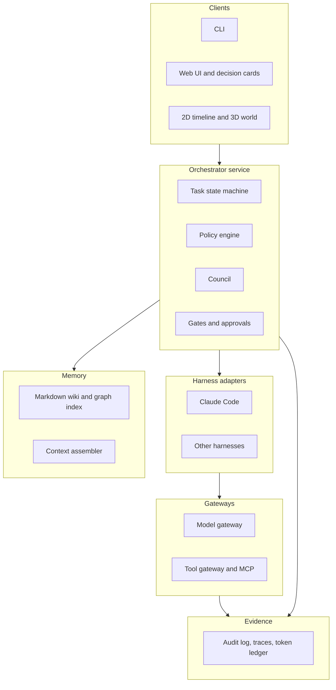

# jarvis-app

A governed, agentic framework for automating the software development lifecycle. AI agents do the work; humans decide only the major decisions; every action is auditable; token spend is budgeted; and the system learns from its mistakes.

> **Status: design phase.** The charter, diagrams and roadmap exist. No framework code has been written yet. "jarvis-app" is the repository's working name.

## What it is

An orchestrator, policy engine, memory and tool layer that sits around existing coding agents (first target: Claude Code) and models. It is reusable on both **greenfield** and **brownfield** projects, with the project-specific parts kept in a `.agents/` folder per repository.

Core ideas:

- **Autonomy tiers and human-in-the-loop.** Agents run continuously. A policy engine, outside the model, decides which decisions are major. A task waiting for a human is parked while other work continues.
- **Enforced boundaries, not prompts.** Permissions, gates, budgets and approvals are enforced in code. Production deploys are human-gated in v1.
- **Memory as an LLM-wiki.** Markdown notes with links and frontmatter (Obsidian-compatible, Obsidian optional), a graph index, and a write gate that validates anything agents propose.
- **Learning through artifacts.** A mistake becomes a CI check, hook, policy rule or playbook before it becomes a note. "Reinforcement learning" here is a feedback loop around the model, not weight updates.
- **Token optimisation and model routing.** Hard context caps, caching, tiered models and per-task budgets, with a ledger of every call.
- **Auditability and accountability.** A hash-chained audit log with OpenTelemetry traces, attributed approvals, no self-approval and a kill switch.
- **Governed tools and MCP.** A registry, risk classes, vetted and pinned MCP servers, short-lived scoped credentials, and injection resistance (trust labels, taint tracking, quarantine, egress allowlist).
- **Portable.** Multiple harnesses and models behind adapters and a model gateway.
- **Optional council and visual layer.** An advisory council for high-risk gates, and a 2D timeline with an optional 3D world driven by real events.

## Architecture at a glance



More diagrams (decision routing, pipeline and gates, memory, learning loop, injection-resistant tool access, roadmap) are in [docs/architecture.md](docs/architecture.md).

## Documentation

| Document | What it covers |
|---|---|
| [Framework charter](docs/framework-charter.md) | Principles, architecture, autonomy tiers, practices for each SDLC phase, cross-cutting controls, roadmap, risks, open decisions, and the verification status of every external claim |
| [Architecture diagrams](docs/architecture.md) | Mermaid diagrams for the system, decision flow, pipeline, memory, learning loop, tool access and roadmap |
| [TODO list](docs/TODO.md) | Phase-by-phase, task-by-task plan with exit checks and a suggested first two weeks |

## Roadmap

| Phase | Focus |
|---|---|
| P0 | Decisions, owners, pilots, baselines |
| P1 | Schemas and repository skeleton |
| P2 | The spine: audit ledger, policy gate, approvals |
| P3 | Memory: wiki, write gate, context assembler |
| P4 | One pipeline end to end |
| P5 | Brownfield onboarding |
| P6 | Evals and red team |
| P7 | Council, router, second harness, visuals, packaging |

Details and task lists are in [docs/TODO.md](docs/TODO.md).

## Planned repository layout

```
core/       orchestrator, policy, council, memory, ledger, gates, tools, security, evals, agents, skills
adapters/   harness adapters (Claude Code first)
packs/      greenfield, brownfield, per-stack conventions
viz/        2D timeline and 3D world
docs/       charter, diagrams, TODO, ADRs
```

Per project, in the target repository:

```
.agents/
  project.yaml    stack, commands, tiers, budgets, no-go paths, enabled tools
  policy.yaml     auto-approve, council, human-required and never rules
  vault/          project memory (Obsidian-compatible Markdown)
```

## Getting started

There is nothing to install or run yet. To contribute to the design:

1. Read the [charter](docs/framework-charter.md), starting with sections 2 (principles) and 4 (autonomy tiers).
2. Pick a task from the [TODO list](docs/TODO.md) and open an issue or pull request referencing its ID (for example `P2.4`).
3. Record notable decisions as ADRs.

## Reference designs

The framework adopts concepts, not dependencies, from [BMAD-METHOD](https://github.com/bmad-code-org/BMAD-METHOD) and [nebula](https://github.com/agentSystemLabs/nebula), and relates to spec-driven tools such as Spec Kit, Kiro and OpenSpec. The charter records what is adopted, what is not, and why. BMAD's trademarks (BMad, BMad Method, BMad Core) are not licensed under its MIT licence and must not be used for this project.

## Evidence and caveats

Much of the external guidance behind the charter comes from vendor and practitioner sources. The charter tags every claim as primary, secondary or our own decision, and lists what is still unverified in its section 16. This project aims to be injection-resilient, not injection-proof.

## Licence

Not yet decided (tracked as task P0.10).
