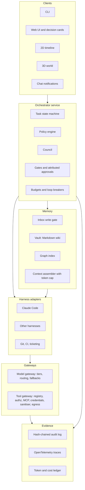
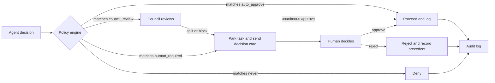
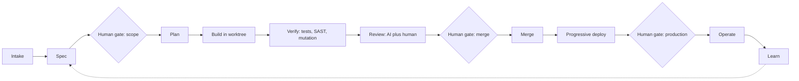
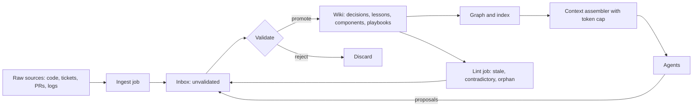
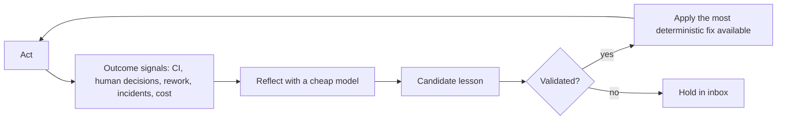
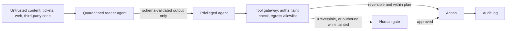
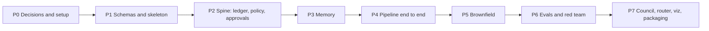

# Architecture diagrams

Companion to the [framework charter](framework-charter.md). The charter is the source of truth; if a diagram and the charter disagree, the charter wins. Diagrams are [Mermaid](https://mermaid.js.org/) and render on GitHub.

## 1. System architecture

Clients talk to one orchestrator service. Harnesses never talk to models or tools directly: everything passes through the gateways, and everything leaves evidence in the ledger.

## 2. Major decisions only: how a decision is routed

The policy engine decides what is "major". Risk comes from evidence (paths, diff size, tools, taint), never from the agent's own claim. A task waiting on a human is parked; other tasks keep running.

## 3. Delivery pipeline and gates

Gates apply only where policy says so. Low-risk changes flow through without a human; production deploy is human-gated in v1.

## 4. Memory: LLM-wiki on Markdown

Agents write only to the inbox. Nothing becomes trusted memory without validation, and memory is data, never instructions.

## 5. Learning loop (feedback around the model, no weight updates)

Prefer a deterministic fix over prose: CI check, then hook or lint rule, then policy rule, then playbook, then wiki note.

## 6. Injection-resistant tool access

Untrusted content is read by a quarantined agent that can only return schema-validated output. The gateway tightens when a session is tainted.

## 7. Roadmap phases

Evals and red-team work starts in phase 2 and is formalised in phase 6. See the [TODO list](TODO.md) for tasks.
